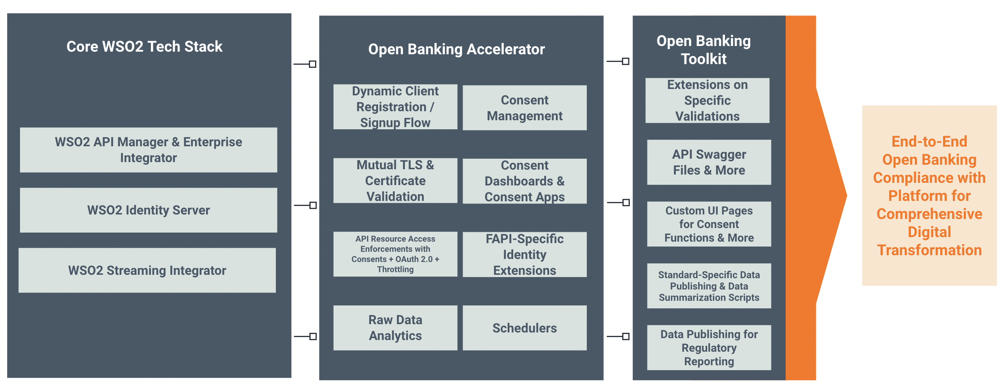

NextGenPSD2 Reference Toolkit is based on the WSO2 Open Banking Accelerator. The toolkit is a purpose-built solution for
regulatory compliance and supports PSD2 and the Berlin Group-NextGenPSD2. It helps align banking and regulatory needs with
technology infrastructures and regulatory expertise to quickly satisfy compliance. To learn about the features available
in this release, see [About this release](./about-this-release.mdx).

To learn how to set up NextGenPSD2 Reference Toolkit, see the [Quick Start Guide](./quick-start-guide/quick-start-guide.mdx).

## WSO2 Open Banking Accelerator

WSO2 Open Banking Accelerator is a collection of technologies that increases the speed and reduces the complexity of
adopting open banking compliance. Instead of building a solution from scratch, you can use WSO2 Open Banking
Accelerator to meet all legislative requirements with additional benefits beyond compliance. The accelerator runs on top
of WSO2 Identity Server and WSO2 API Manager. Given below is the model of WSO2 Open Banking Accelerator:

For more information,
see [WSO2 Open Banking Accelerator](docs:financial-services/3.0.0/) documentation.
